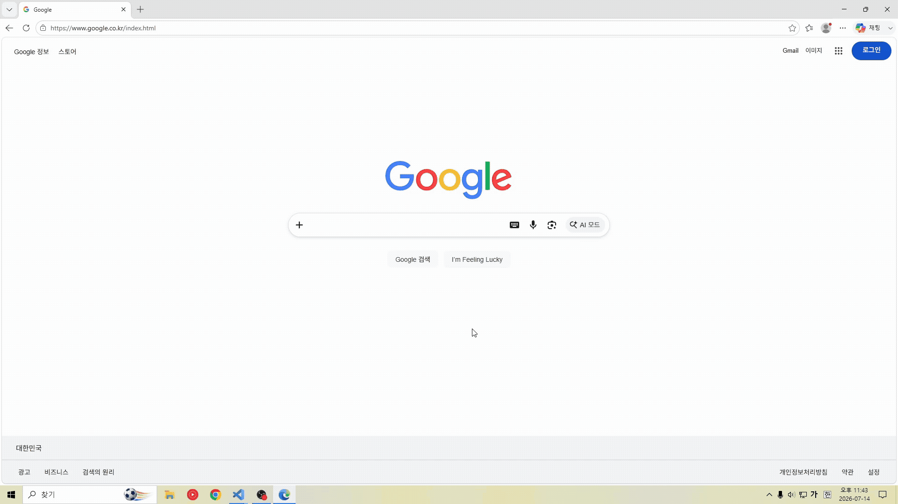
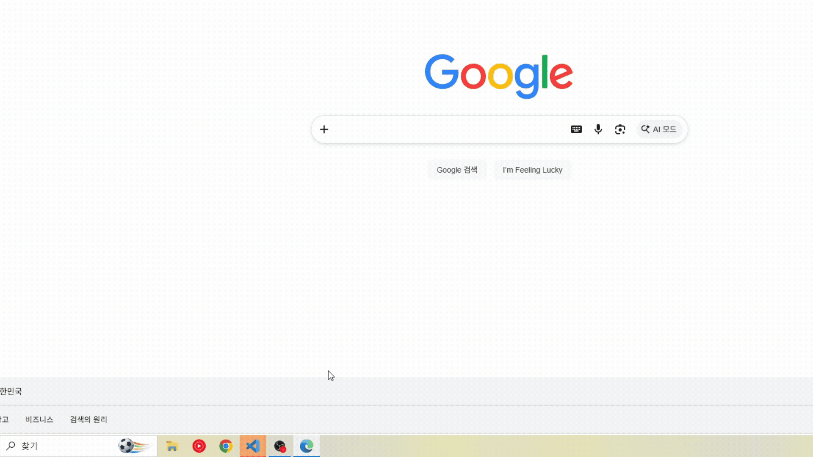

# Job-Finish

**[English](README.md) · [한국어](README.ko.md) · [中文](README.zh.md) · 日本語**

AI エージェントの作業が終わったか、チャットを見続ける必要はありません。
**Claude Code や Codex の作業完了・入力待ち・エラー**を Job-Finish が通知し、作業中の VS Code ウィンドウへ戻れます。

| Windows のトースト通知 | タスクバーの点滅 |
| :---: | :---: |
|  |  |
| 通知をクリックして、作業中の VS Code ウィンドウへ | 通知を見逃しても、応答を待つウィンドウがわかる |

*この GIF は旧バージョンの通知動作を示しています。現在の拡張機能ではトーストの外観が異なる場合があります。*


## 主な機能

| 機能 | できること |
| --- | --- |
| **Claude Code + Codex** | 既存の VS Code 拡張機能で、対応するエージェントの動作を自動検出します。 |
| **作業完了・入力待ち・エラーの通知** | 作業の完了・エラーと、選択肢の選択・質問への回答・承認待ちを知らせます。 |
| **クリックして戻る** | 複数のウィンドウを開いていても、通知を送った VS Code ウィンドウを前面に表示します。 |
| **タスクバーの点滅** | ウィンドウに戻るか、設定した時間が経過するまで、作業中のウィンドウを目立たせます。 |
| **フォーカスを考慮した通知** | そのウィンドウを操作している間は、新しいトースト通知や点滅を行いません。 |
| **最近の結果** | **Job-Finish: Show Results** でエージェントの応答を確認できます。 |

## インストールと更新

**Windows x64、VS Code 1.99 以降、Node.js 22 以降、信頼済みのローカルワークスペース**が必要です。使用する Codex または Claude Code の VS Code 拡張機能をインストールし、ログインしてから実行してください。

```powershell
npx job-finish@latest install
```

パッケージに同梱された VS Code 拡張機能をインストールし、検出した旧 PowerShell/C# 版をバックアップ・削除します。プロジェクトのフォルダーで実行すると、そのプロジェクトの旧版も整理します。再読み込みを求められたら VS Code を再読み込みしてください。Job-Finish は自動的に起動し、.NET を別途インストールする必要はありません。

更新する場合は次のコマンドを実行します。

```powershell
npx job-finish@latest update
```

`--dry-run` を追加すると変更内容を確認でき、`--profile "Profile name"` で VS Code のプロファイルを選べます。同じバージョンまたは新しいバージョンの拡張機能は維持します。詳細は [インストーラーガイド](tools/installer/README.md) を参照してください。

<details>
<summary>CLI をグローバルにインストールする</summary>

```powershell
npm install -g job-finish@latest
job-finish install
```

最新の CLI をインストールした後は、`job-finish update` と `job-finish uninstall` も使用できます。

</details>

<details>
<summary>VSIX を手動でインストールする</summary>

1. 以下のソースビルド手順で `job-finish-win32-x64.vsix` を用意します。
2. VS Code で `Ctrl+Shift+P` を押し、**Extensions: Install from VSIX…** を選択します。
3. VSIX ファイルを選択し、再読み込みを求められたら実行します。

更新も同じ手順で新しい VSIX をインストールします。手動インストールでは旧 PowerShell/C# 版を削除しません。

</details>

<details>
<summary>ソースから VSIX をビルドする</summary>

**Node.js 22 以降と .NET SDK 8 以降**を用意し、リポジトリのルートで次のコマンドを実行します。

```powershell
npm ci
npm run check
npm run package
```

`job-finish-win32-x64.vsix` が生成されます。開発用ウィンドウを開く場合は、代わりに `F5` を押します。

旧 PowerShell/C# 版を使用していた場合は、インストーラーで旧版をバックアップ・削除してから拡張機能をインストールできます。

```powershell
npm --prefix tools/installer ci
npm run install:extension -- --vsix ./job-finish-win32-x64.vsix
```

</details>

## 拡張機能の使い方

1. VS Code の普段の Codex または Claude Code チャットで作業します。Job-Finish は初期状態で有効です。
2. 作業中のウィンドウが非アクティブなとき、完了・エラー・選択や回答、承認の依頼をトースト通知とタスクバーの点滅で知らせます。
3. 通知をクリックしてそのウィンドウに戻り、元のチャットで選択・回答・承認を行います。

`Ctrl+Shift+P` でコマンドパレットを開き、**Job-Finish** を検索します。

| コマンド | 用途 |
| --- | --- |
| **Show Results** | 最近の応答を確認します。 |
| **Stop Flash** | タスクバーの点滅をすぐに停止します。 |
| **Show Diagnostics** | 検出と通知の状態を確認します。 |
| **Bind This Windows Window** | 通知クリックと点滅に使用する現在の Windows ウィンドウを確認します。 |

自動検出の対象は、同じ VS Code Extension Host 内で動作するローカルエージェントです。WSL、リモートワークスペース、外部ターミナルのエージェント、エージェントのデスクトップアプリは対象外です。プロバイダーの更新後に検出できなくなった場合は、**Show Diagnostics** を確認してください。

## 主な設定

VS Code の設定（`Ctrl+,`）を開き、**Job-Finish** を検索します。

| 設定 | 初期値 | 説明 |
| --- | --- | --- |
| `jobFinish.enabled` | `true` | 自動検出と通知の有効・無効をすぐに切り替えます。 |
| `jobFinish.toast` | `true` | Windows のトースト通知を表示します。 |
| `jobFinish.toastIcon` | `true` | 通知本文に既定の眠るキャラクター画像を表示します。無効にするとテキストだけを表示します。 |
| `jobFinish.toastIconPath` | 空欄 | ローカルの PNG・JPEG・GIF・BMP 画像を指定します。空欄は既定画像、相対パスは最初のワークスペースフォルダーを基準にします。 |
| `jobFinish.flash` | `true` | 作業中の VS Code ウィンドウをタスクバーで点滅させます。 |
| `jobFinish.flashMode` | `manual` | `manual`：0.5 秒ごとに点滅。`system`：Windows 標準の点滅動作を使用。 |
| `jobFinish.flashTimeoutSeconds` | `300` | 指定した秒数で点滅を停止します。`0` の場合は、ウィンドウに戻る、通知をクリックする、または **Stop Flash** を実行するまで続きます。 |

## アンインストール

VS Code の拡張機能で **Job-Finish → Uninstall** を選択するか、次のコマンドを実行します。

```powershell
code --uninstall-extension JobFinish.JobFinish
```

再読み込みを求められたら実行してください。特定のプロファイルには `--profile "Profile name"` を追加します。

旧 PowerShell/C# 版も使用していた場合は、フックとインストールファイルを別途確認して削除します。

```powershell
npx job-finish@latest uninstall --dry-run
npx job-finish@latest uninstall
```

npm の `uninstall` は旧 PowerShell/C# 版だけを削除します。ファイルを残す場合は `--keep-files`、別のプロジェクトには `--project "C:\Projects\MyProject"` を追加してください。バックアップについては[インストーラーガイド](tools/installer/README.md)を参照してください。

CLI をグローバルにインストールした場合は、別途削除します。

```powershell
npm uninstall -g job-finish
```

実装と検証の詳細は[開発ドキュメント](docs/requirements-and-verification.md)と[検証レポート](docs/verification.md)を参照してください。

## 変更履歴

<details>
<summary>v2.3.1（v2.3.0 以降）</summary>

### npm と Marketplace の紹介を統一

通知とタスクバーの GIF デモ、バージョン別の変更履歴を含むこの README を、両方のパッケージページで使用します。GIF は公開 HTTPS URL を使い、npm のドキュメントリンクは絶対 URL に変換します。

### リリースバージョンの統一

npm インストーラーと Windows x64 VSIX を 2.3.1 に統一しました。Marketplace の発行元は `JobFinish`、拡張機能 ID は `JobFinish.JobFinish` を維持します。

</details>

<details>
<summary>v2.3.0（v2.2.0 以降）</summary>

### 自動通知に機能を集約

直接実行・セッション管理コマンド・実行設定・同梱 Claude SDK を削除し、既存拡張の通知検出に集約しました。

### コマンドと設定の簡素化

コマンドを4個、General・Notifications の設定を7個に整理しました。質問への回答・承認・会話管理は元の Codex・Claude UI で行い、保存上限で省略された応答には案内を表示します。

### 重複する完了通知の抑制

非同期の質問はすぐに通知します。同じターンで質問から5秒以内に正常完了した場合、両方の結果を保存し、追加の通知と点滅をまとめます。エラーとキャンセルは個別に通知します。

### ネイティブ通知の診断追加

制御されたストリームで質問の再送・完了タイミング・Windows 通知の送信・クリックコールバックを確認する診断スクリプトを追加しました。

</details>

<details>
<summary>v2.2.0（v2.1.2 以降）</summary>

### 内部構造のリファクタリング

エージェント実行・セッション管理・通信・Windows 通知を役割ごとに分離し、共通の処理フローを整理しました。

### 通知タイトルとアイコンの改善

通知にセッションタイトルを表示し、VS Code アイコンと既定の画像を復元しました。

### 設定カテゴリの整理

設定を General・Notifications・Codex・Claude に分け、必要な項目を見つけやすくしました。

### Codex の非同期質問通知

Codex の非同期質問イベントを検出し、ユーザー入力が必要なときに通知を表示します。

### 既存インストールからの更新経路の復元

既存の npm・Marketplace インストールから新しいバージョンへ更新できるようにしました。

</details>

## ライセンス

[MIT](LICENSE)。同梱するサードパーティのコンポーネントには、それぞれのライセンスが適用されます。
