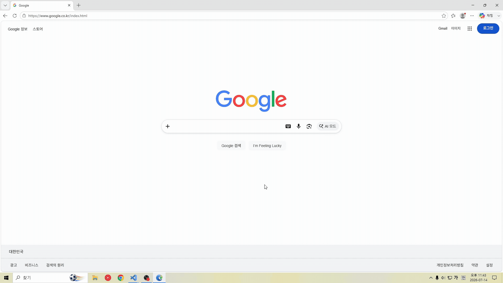
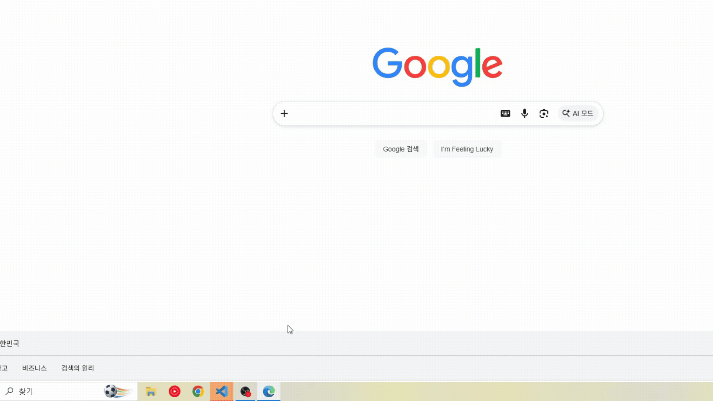

# Job-Finish

**[English](README.md) · 한국어 · [中文](README.zh.md) · [日本語](README.jp.md)**

AI 에이전트가 끝났는지 확인하려고 채팅창을 계속 보고 있을 필요 없습니다.
**Claude Code·Codex의 작업 완료, 입력 대기, 오류**를 알리고, 클릭 한 번으로 해당 VS Code 창에 돌아오는 확장입니다.

| Windows 토스트 알림 | 작업 표시줄 깜빡임 |
| :---: | :---: |
|  |  |
| 알림을 클릭하면 작업하던 VS Code 창으로 복귀 | 토스트를 놓쳐도 입력·완료를 기다리는 창을 확인 |

*GIF는 이전 버전의 알림 동작 예시입니다. 현재 확장의 토스트 모양은 다를 수 있습니다.*


## 주요 기능 한눈에 보기

| 기능 | 설명 |
| --- | --- |
| **Claude Code + Codex** | 기존 VS Code 확장에서 실행하는 지원 대상 작업을 자동으로 감지합니다. |
| **완료·입력 대기·오류 알림** | 작업 완료·오류와 선택지 선택·질문 답변·승인 대기를 알립니다. |
| **클릭으로 해당 창 복귀** | 여러 VS Code 창을 열어도 알림을 보낸 작업의 창으로 돌아갑니다. |
| **작업 표시줄 깜빡임** | 창으로 돌아오거나 설정 시간이 지날 때까지 작업 창을 강조합니다. |
| **포커스 인식** | 이미 해당 창을 보고 있으면 새 토스트와 깜빡임을 생략합니다. |
| **최근 결과 확인** | **Job-Finish: Show Results**에서 에이전트의 응답을 다시 봅니다. |

## 설치 및 업데이트

**Windows x64, VS Code 1.99 이상, Node.js 22 이상, 신뢰된 로컬 작업 폴더**에서 사용합니다. 사용할 Codex 또는 Claude Code VS Code 확장을 설치하고 로그인한 뒤 실행하세요.

```powershell
npx job-finish@latest install
```

패키지에 포함된 VS Code 확장을 설치하고, 발견한 예전 PowerShell/C# 설치본은 백업 후 정리합니다. 프로젝트 폴더에서 실행하면 해당 프로젝트의 예전 설치본도 정리합니다. VS Code 다시 로드 안내가 나오면 실행하세요. Job-Finish는 자동으로 켜지며 .NET은 별도로 설치할 필요가 없습니다.

업데이트할 때는 다음 명령을 사용합니다.

```powershell
npx job-finish@latest update
```

미리보기는 `--dry-run`, 특정 VS Code 프로필은 `--profile "프로필 이름"`을 추가합니다. 같은 버전이나 더 최신인 확장은 유지합니다. 자세한 내용은 [설치 도구 안내](tools/installer/README.md)를 참고하세요.

<details>
<summary>CLI를 전역 설치해서 사용하기</summary>

```powershell
npm install -g job-finish@latest
job-finish install
```

최신 CLI 설치 후 `job-finish update`, `job-finish uninstall`도 사용할 수 있습니다.

</details>

<details>
<summary>VSIX 파일로 직접 설치하기</summary>

1. 아래 소스 빌드 안내로 `job-finish-win32-x64.vsix`를 준비합니다.
2. VS Code에서 `Ctrl+Shift+P` → **Extensions: Install from VSIX…**를 선택합니다.
3. VSIX 파일을 선택하고, 다시 로드 안내가 나오면 실행합니다.

업데이트도 새 VSIX를 같은 방법으로 설치하면 됩니다. 직접 설치하면 예전 PowerShell/C# 설치본은 정리하지 않습니다.

</details>

<details>
<summary>소스에서 VSIX 빌드하기</summary>

**Node.js 22 이상과 .NET SDK 8 이상**에서 저장소 루트를 열고 실행합니다.

```powershell
npm ci
npm run check
npm run package
```

`job-finish-win32-x64.vsix`가 생성됩니다. 개발용 창을 열려면 `F5`를 사용합니다.

예전 PowerShell/C# 버전을 사용했다면, 설치 도구로 기존 설치를 백업·정리하면서 확장을 설치할 수 있습니다.

```powershell
npm --prefix tools/installer ci
npm run install:extension -- --vsix ./job-finish-win32-x64.vsix
```

</details>

## 확장 사용법

1. VS Code의 기존 Codex·Claude Code 채팅창에서 평소처럼 작업합니다. Job-Finish는 기본으로 켜져 있습니다.
2. 작업 창이 비활성일 때 완료·오류·선택지/질문/승인 대기를 토스트와 작업 표시줄 깜빡임으로 알려줍니다.
3. 토스트를 클릭해 해당 창으로 돌아와 원래 채팅창에서 선택하거나 답변·승인합니다.

`Ctrl+Shift+P`로 명령 팔레트를 열고 **Job-Finish**를 검색합니다.

| 명령 | 용도 |
| --- | --- |
| **Show Results** | 최근 에이전트 응답 확인 |
| **Stop Flash** | 작업 표시줄 깜빡임 즉시 정지 |
| **Show Diagnostics** | 자동 감지·알림 연결 상태 확인 |
| **Bind This Windows Window** | 알림 클릭·깜빡임에 사용할 현재 Windows 창 연결 확인 |

자동 감지는 같은 VS Code Extension Host에서 실행되는 로컬 에이전트를 지원합니다. WSL·원격 작업 폴더·외부 터미널·데스크톱 에이전트 앱은 대상에 포함되지 않습니다. 에이전트 확장 업데이트 후 감지가 안 되면 **Show Diagnostics**에서 상태를 확인하세요.

토스트가 누락되면 **Show Diagnostics**에서 누적 로그와 현재 상태를 확인하세요. 재현 방법·로그 파일 위치·생략 사유는 [토스트 누락 로그 안내](docs/notification-debugging.md)를 참고하세요.

긴 응답은 토스트 본문의 최대 4줄 안에서 말줄임됩니다. 빈 줄을 정리해 표시 공간을 활용하며, **Toast Icon**을 끄면 이미지 없이 본문 너비를 넓게 사용합니다. 더 긴 내용은 **Show Results**에서 확인할 수 있습니다.

## 기본 설정 한눈에 보기

VS Code 설정(`Ctrl+,`)에서 **Job-Finish**를 검색합니다.

| 설정 | 기본값 | 설명 |
| --- | --- | --- |
| `jobFinish.enabled` | `true` | 자동 감지와 알림을 즉시 켜거나 끕니다. |
| `jobFinish.toast` | `true` | Windows 토스트 알림을 표시합니다. |
| `jobFinish.toastIcon` | `true` | 토스트 본문에 기본 잠자는 캐릭터 이미지를 표시합니다. 끄면 텍스트만 표시합니다. |
| `jobFinish.toastIconPath` | 빈 값 | 로컬 PNG·JPEG·GIF·BMP 이미지 경로입니다. 빈 값은 기본 이미지, 상대 경로는 첫 작업 폴더를 기준으로 합니다. |
| `jobFinish.flash` | `true` | 작업하던 VS Code 창의 작업 표시줄 버튼을 깜빡입니다. |
| `jobFinish.flashMode` | `manual` | `manual`: 0.5초마다 직접 깜빡임. `system`: Windows 기본 깜빡임 방식 사용. |
| `jobFinish.flashTimeoutSeconds` | `300` | 깜빡임 유지 시간(초). `0`이면 창 복귀·토스트 클릭·**Stop Flash**까지 유지합니다. |

## 삭제

VS Code 확장 목록에서 **Job-Finish → 제거(Uninstall)**를 선택하거나 다음 명령을 실행합니다.

```powershell
code --uninstall-extension JobFinish.JobFinish
```

다시 로드 안내가 나오면 실행하세요. 특정 프로필에는 `--profile "프로필 이름"`을 추가합니다.

예전 PowerShell/C# 버전도 사용했다면, 해당 훅과 설치 파일은 별도로 미리보기 후 정리합니다.

```powershell
npx job-finish@latest uninstall --dry-run
npx job-finish@latest uninstall
```

npm의 `uninstall` 명령은 예전 PowerShell/C# 설치본만 제거합니다. 파일을 남기려면 `--keep-files`, 다른 프로젝트는 `--project "C:\Projects\MyProject"`를 추가하세요. 백업 동작은 [설치 도구 안내](tools/installer/README.md)를 참고하세요.

CLI를 전역 설치했다면 별도로 제거합니다.

```powershell
npm uninstall -g job-finish
```

내부 동작과 검증 결과는 [개발 문서](docs/requirements-and-verification.md)와 [검증 보고서](docs/verification.md)에서 확인할 수 있습니다.

## 변경 사항

<details>
<summary>v2.3.2 (v2.3.1 이후)</summary>

### 긴 토스트 본문 표시 개선

고정 180자 제한을 최대 1,024자 미리보기로 바꾸고 빈 줄과 공백을 정리했습니다. Windows가 제목 최대 2줄·본문 최대 4줄에 맞춰 표시하며, **Toast Icon**을 끄면 넓어진 본문 영역을 활용합니다.

### 큰 응답 이후에도 완료 감지 유지

Codex·Claude의 큰 응답 이후 완료 감지가 중단되는 문제를 수정했습니다. 관찰용 긴 문자열만 줄이고, 그래도 상한을 넘는 프레임은 생략한 뒤 다음 이벤트부터 감지를 이어갑니다.

### Codex 서브에이전트 알림 판정 개선

생성 이벤트와 단일·목록 메타데이터로 하위 대화를 제외합니다. 부모·형제에게 보낸 메시지 때문에 메인 대화의 알림까지 잘못 차단되던 문제도 수정했습니다.

### 알림 진단 보강과 빌드 분리

이벤트 감지부터 알림 생략·Windows 전달까지의 추적과 Codex 스레드 제외 판정 로그를 추가했습니다. 자동 추적은 `npm run build:diagnostics`로 만드는 별도 진단 빌드에서 제공하며, 일반 빌드에는 **Show Diagnostics**의 현재 상태 조회와 오류 보관을 유지합니다.

### 확장 아이콘 교체

확장 아이콘 이미지를 교체했습니다.

</details>

<details>
<summary>v2.3.1 (v2.3.0 이후)</summary>

### npm·Marketplace 기본 소개 통일

토스트·작업 표시줄 GIF 데모와 버전별 변경 내역이 있는 이 README를 두 패키지 페이지에 함께 사용합니다. GIF는 공개 HTTPS 주소를 사용하고 npm의 문서 링크는 절대주소로 변환합니다.

### 배포 버전 일치

npm 설치 도구와 Windows x64 VSIX 버전을 모두 2.3.1로 맞췄습니다. Marketplace 배포자는 `JobFinish`, 확장 ID는 `JobFinish.JobFinish`를 유지합니다.

</details>

<details>
<summary>v2.3.0 (v2.2.0 이후)</summary>

### 자동 알림 전용으로 정리

직접 실행·세션 관리 명령과 실행 설정, Claude SDK를 제거하고 기존 확장의 알림 감지에 집중했습니다.

### 명령과 설정 간소화

명령 4개와 General·Notifications의 설정 7개만 남겼습니다. 질문 답변·승인·대화 관리는 원래 Codex·Claude UI에서 처리하며, 저장 상한으로 잘린 결과에는 안내를 표시합니다.

### 중복 완료 알림 억제

비동기 질문은 즉시 알립니다. 같은 턴에서 질문 뒤 5초 이내 정상 완료되면 질문·완료 결과는 모두 보관하고 추가 토스트·깜박임을 합칩니다. 오류·취소는 별도로 알립니다.

### 네이티브 토스트 진단 추가

제어된 스트림으로 동일 질문의 재전송·완료 시점·Windows 토스트 제출·클릭 콜백을 검사하는 진단 스크립트를 추가했습니다.

</details>

<details>
<summary>v2.2.0 (v2.1.2 이후)</summary>

### 내부 구조 리팩토링

에이전트 실행·세션 관리·통신·Windows 알림을 역할별로 분리하고 공통 처리 흐름을 정리했습니다.

### 토스트 제목·아이콘 개선

토스트에 세션 제목을 표시하고 VS Code 아이콘과 기본 이미지를 복원했습니다.

### 설정 카테고리 정리

설정을 General·Notifications·Codex·Claude로 나눠 필요한 항목을 쉽게 찾을 수 있도록 했습니다.

### Codex 비동기 질문 알림

Codex의 비동기 질문 이벤트를 감지해 사용자 입력이 필요한 시점에 토스트를 표시합니다.

### 기존 배포본 업데이트 경로 복원

기존 npm·Marketplace 배포본을 사용하던 환경에서도 새 버전으로 업데이트할 수 있도록 했습니다.

</details>

## 라이선스

[MIT](LICENSE). 포함된 외부 구성요소는 각각의 라이선스를 따릅니다.
