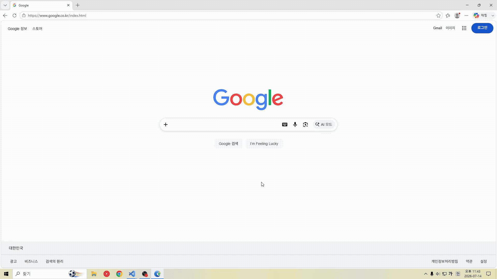
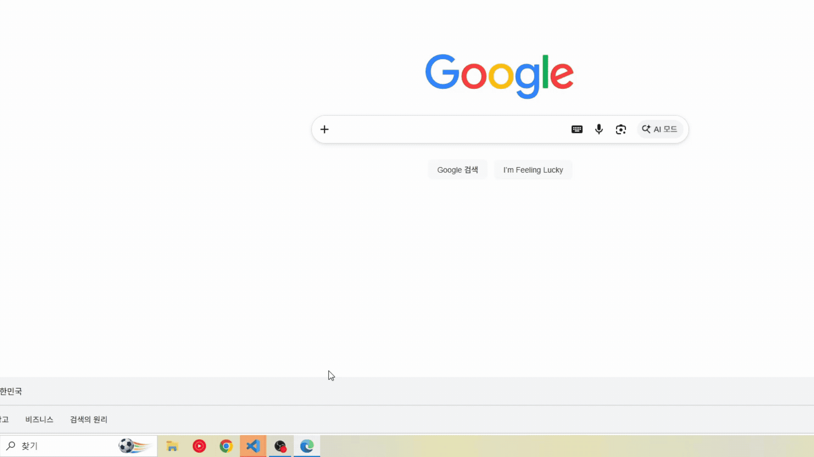

# Job-Finish

**English · [한국어](README.ko.md) · [中文](README.zh.md) · [日本語](README.jp.md)**

Stop watching the chat to see whether your AI agent is done.
When **Claude Code or Codex finishes, needs input, or encounters an error**, Job-Finish notifies you and brings you back to the right VS Code window.

| Windows toast notification | Taskbar flashing |
| :---: | :---: |
|  |  |
| Click the toast to return to the task's VS Code window | Spot the waiting window even if you miss the toast |

*These GIFs show the earlier version's notification behavior; the current extension's toast appearance may differ.*


## Features at a glance

| Feature | What you get |
| --- | --- |
| **Claude Code + Codex** | Automatically detects supported activity in the existing VS Code extensions. |
| **Completion, input, and error alerts** | Alerts you when tasks finish, fail, or wait for a choice, answer, or approval. |
| **Click to return** | Brings the VS Code window that sent the notification to the front, including when several windows are open. |
| **Taskbar flashing** | Highlights the task's window until you return or the configured timeout expires. |
| **Focus awareness** | Skips new toasts and flashing while you are already looking at that window. |
| **Recent results** | Review the agent's responses with **Job-Finish: Show Results**. |

## Install and update

Requires **Windows x64, VS Code 1.99+, Node.js 22+, and a trusted local workspace**. Install and sign in to the Codex or Claude Code VS Code extension you use, then run:

```powershell
npx job-finish@latest install
```

The installer installs the bundled VS Code extension and backs up and removes detected old PowerShell/C# installations. Run it from your project folder to include that project's old installation. Reload VS Code if prompted; Job-Finish starts automatically. No separate .NET installation is needed.

To update:

```powershell
npx job-finish@latest update
```

Add `--dry-run` to preview changes or `--profile "Profile name"` to choose a VS Code profile. Equal or newer extension versions are preserved. See the [installer guide](tools/installer/README.md) for details.

<details>
<summary>Install the CLI globally</summary>

```powershell
npm install -g job-finish@latest
job-finish install
```

After installing the latest CLI, you can also use `job-finish update` and `job-finish uninstall`.

</details>

<details>
<summary>Install a VSIX manually</summary>

1. Prepare `job-finish-win32-x64.vsix` using the source build steps below.
2. In VS Code, press `Ctrl+Shift+P` and select **Extensions: Install from VSIX…**.
3. Select the VSIX file and reload VS Code if prompted.

To update, install the new VSIX the same way. Manual installation does not remove old PowerShell/C# installations.

</details>

<details>
<summary>Build the VSIX from source</summary>

With **Node.js 22+ and .NET SDK 8+**, run these commands from the repository root:

```powershell
npm ci
npm run check
npm run package
```

The output is `job-finish-win32-x64.vsix`. Press `F5` instead to open a development window.

If you used the old PowerShell/C# version, the installer can back up and remove it before installing the extension:

```powershell
npm --prefix tools/installer ci
npm run install:extension -- --vsix ./job-finish-win32-x64.vsix
```

</details>

## Use the extension

1. Work in your usual Codex or Claude Code chat in VS Code. Job-Finish is enabled by default.
2. While the task's window is inactive, completion, errors, and requests for a choice, answer, or approval trigger a toast and taskbar flashing.
3. Click the toast to return to that window and respond in the original chat.

Open the command palette with `Ctrl+Shift+P` and search for **Job-Finish**:

| Command | Purpose |
| --- | --- |
| **Show Results** | Review recent responses. |
| **Stop Flash** | Stop taskbar flashing immediately. |
| **Show Diagnostics** | Check detection and notification status. |
| **Bind This Windows Window** | Verify the native window used for notification clicks and flashing. |

Automatic detection supports local agents in the same VS Code Extension Host. WSL, remote workspaces, external terminal agents, and desktop agent apps are outside this scope. If detection stops working after a provider update, check **Show Diagnostics**.

## Settings at a glance

Open VS Code Settings (`Ctrl+,`) and search for **Job-Finish**.

| Setting | Default | Description |
| --- | --- | --- |
| `jobFinish.enabled` | `true` | Turn automatic detection and notifications on or off immediately. |
| `jobFinish.toast` | `true` | Show Windows toast notifications. |
| `jobFinish.toastIcon` | `true` | Show the default sleeping character beside the toast body. Turn off for text-only notifications. |
| `jobFinish.toastIconPath` | empty | Use a local PNG, JPEG, GIF, or BMP image. Empty uses the default image; relative paths start at the first workspace folder. |
| `jobFinish.flash` | `true` | Flash the task's VS Code window in the taskbar. |
| `jobFinish.flashMode` | `manual` | `manual`: flash every 0.5 seconds. `system`: use Windows' default flashing behavior. |
| `jobFinish.flashTimeoutSeconds` | `300` | Stop flashing after this many seconds. `0` keeps it going until focus returns, the toast is clicked, or **Stop Flash** is used. |

## Uninstall

Remove the VS Code extension through **Extensions → Job-Finish → Uninstall**, or run:

```powershell
code --uninstall-extension JobFinish.JobFinish
```

Reload VS Code if prompted. For a specific profile, add `--profile "Profile name"`.

If you also used the old PowerShell/C# version, preview and remove its hooks and installation files separately:

```powershell
npx job-finish@latest uninstall --dry-run
npx job-finish@latest uninstall
```

The npm `uninstall` command removes only the old PowerShell/C# installation. Add `--keep-files` to keep its files or `--project "C:\Projects\MyProject"` for another project. See the [installer guide](tools/installer/README.md) for backup behavior.

If you installed the CLI globally, remove it separately:

```powershell
npm uninstall -g job-finish
```

For implementation details and verification, see the [development document](docs/requirements-and-verification.md) and [verification report](docs/verification.md).

## Release notes

<details>
<summary>v2.3.2 (since v2.3.1)</summary>

### Longer toast previews

Replaced the fixed 180-character cutoff with a preview of up to 1,024 characters and cleaned up whitespace. Windows fits the title into up to two lines and the body into up to four, using the wider text area when **Toast Icon** is off.

### Completion detection after large responses

Large Codex and Claude responses no longer stop subsequent completion detection. Long strings are shortened only in the observer; frames that still exceed its limit are skipped so observation can continue with the next event.

### More accurate Codex subagent filtering

Exclude child conversations using creation events and both individual and list metadata. Messages to parents or siblings no longer incorrectly suppress the main conversation's notifications.

### Notification diagnostics and separate builds

Added diagnostic traces from event detection through notification filtering and Windows delivery, including Codex thread exclusion decisions. Automatic tracing is available in a separate build through `npm run build:diagnostics`; normal builds retain **Show Diagnostics** snapshots and stored errors.

### Updated extension icon

Replaced the extension icon image.

</details>

<details>
<summary>v2.3.1 (since v2.3.0)</summary>

### Shared npm and Marketplace introduction

Both package pages use this README, including the animated toast and taskbar demos and version-by-version release notes. GIFs use public HTTPS URLs, and npm document links are converted to absolute URLs.

### Matching release versions

The npm installer and the Windows x64 VSIX are both version 2.3.1. The Marketplace publisher remains `JobFinish`, with extension ID `JobFinish.JobFinish`.

</details>

<details>
<summary>v2.3.0 (since v2.2.0)</summary>

### Automatic notifications only

Removed direct agent execution, session management commands, execution settings, and the bundled Claude SDK.

### Simpler commands and settings

Kept four commands and seven settings under General and Notifications. Answer questions and manage conversations in the original Codex or Claude UI. Results show when a saved response was truncated.

### Duplicate completion notification suppression

Asynchronous questions alert immediately. A successful completion within five seconds of a question in the same turn keeps both results and merges the additional toast and flash. Errors and cancellations keep their own alerts.

### Native toast diagnostics

Added a controlled-stream diagnostic script to check repeated question events, completion timing, native toast submission, and click callbacks.

</details>

<details>
<summary>v2.2.0 (since v2.1.2)</summary>

### Internal refactoring

Separated agent execution, session management, transport, and Windows notifications by responsibility and simplified shared processing flows.

### Toast titles and icons

Added session titles to toasts and restored the VS Code icon and default image.

### Settings categories

Grouped options under General, Notifications, Codex, and Claude.

### Codex asynchronous question notifications

Detect asynchronous Codex question events and show a toast when user input is needed.

### Update paths for existing installations

Restored updates to the new version for existing npm and Marketplace installations.

</details>

## License

[MIT](LICENSE). Bundled third-party components retain their respective licenses.
