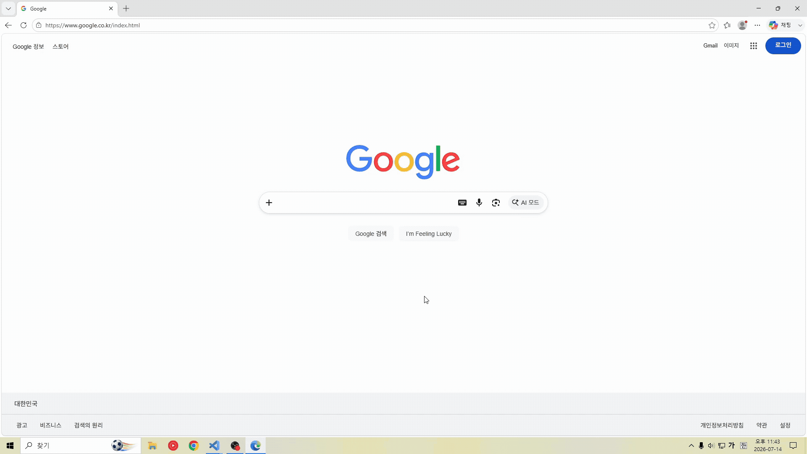
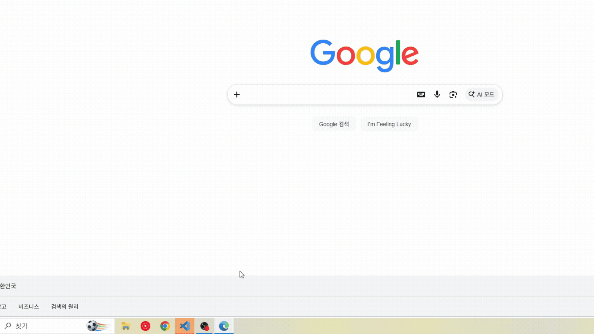

# Job-Finish

**[English](README.md) · [한국어](README.ko.md) · 中文 · [日本語](README.jp.md)**

不用一直盯着聊天窗口，等待 AI 智能体完成任务。
当 **Claude Code 或 Codex 完成任务、需要输入或遇到错误时**，Job-Finish 会通知你，并带你回到对应的 VS Code 窗口。

| Windows 通知 | 任务栏闪烁 |
| :---: | :---: |
|  |  |
| 点击通知，回到该任务所在的 VS Code 窗口 | 即使错过通知，也能看到等待你处理的窗口 |

*这些 GIF 展示的是早期版本的通知行为；当前扩展的通知外观可能有所不同。*


## 功能一览

| 功能 | 说明 |
| --- | --- |
| **Claude Code + Codex** | 自动检测现有 VS Code 扩展中受支持的活动。 |
| **任务完成、输入与错误提醒** | 提醒任务完成、错误，以及等待选项选择、问题回答或批准的状态。 |
| **点击返回** | 将发送通知的 VS Code 窗口置于前台，同时打开多个窗口时也能准确返回。 |
| **任务栏闪烁** | 持续突出显示任务所在的窗口，直到你返回或达到设置的超时时间。 |
| **感知窗口焦点** | 当你正在查看该窗口时，不发送新的通知，也不启动闪烁。 |
| **最近结果** | 通过 **Job-Finish: Show Results** 查看智能体的回复。 |

## 安装与更新

需要 **Windows x64、VS Code 1.99+、Node.js 22+ 和受信任的本地工作区**。请安装并登录你使用的 Codex 或 Claude Code VS Code 扩展，然后运行：

```powershell
npx job-finish@latest install
```

安装程序会安装包中附带的 VS Code 扩展，并备份和移除检测到的旧 PowerShell/C# 安装。请在项目文件夹中运行，以便同时清理该项目的旧安装。在出现提示时重新加载 VS Code；Job-Finish 会自动启动，无需单独安装 .NET。

更新时运行：

```powershell
npx job-finish@latest update
```

添加 `--dry-run` 可预览更改，添加 `--profile "Profile name"` 可选择 VS Code 配置文件。安装程序会保留相同或更新版本的扩展。详情见[安装程序指南](tools/installer/README.md)。

<details>
<summary>全局安装 CLI</summary>

```powershell
npm install -g job-finish@latest
job-finish install
```

安装最新 CLI 后，也可以使用 `job-finish update` 和 `job-finish uninstall`。

</details>

<details>
<summary>手动安装 VSIX</summary>

1. 按照下方的源码构建步骤生成 `job-finish-win32-x64.vsix`。
2. 在 VS Code 中按 `Ctrl+Shift+P`，选择 **Extensions: Install from VSIX…**。
3. 选择 VSIX 文件，并在出现提示时重新加载 VS Code。

更新时，用同样的方法安装新的 VSIX。手动安装不会移除旧的 PowerShell/C# 安装。

</details>

<details>
<summary>从源码构建 VSIX</summary>

安装 **Node.js 22+ 和 .NET SDK 8+** 后，在仓库根目录运行：

```powershell
npm ci
npm run check
npm run package
```

生成的文件为 `job-finish-win32-x64.vsix`。开发时也可以按 `F5` 打开开发窗口。

如果你使用过旧的 PowerShell/C# 版本，安装程序可以在安装扩展前备份并移除旧版：

```powershell
npm --prefix tools/installer ci
npm run install:extension -- --vsix ./job-finish-win32-x64.vsix
```

</details>

## 使用扩展

1. 照常在 VS Code 中使用 Codex 或 Claude Code 聊天。Job-Finish 默认启用。
2. 当任务窗口处于非活动状态时，任务完成、错误或等待选择、回答、批准都会触发通知和任务栏闪烁。
3. 点击通知回到对应窗口，在原来的聊天中选择选项、回答问题或批准请求。

按 `Ctrl+Shift+P` 打开命令面板，搜索 **Job-Finish**：

| 命令 | 用途 |
| --- | --- |
| **Show Results** | 查看最近的回复。 |
| **Stop Flash** | 立即停止任务栏闪烁。 |
| **Show Diagnostics** | 检查检测与通知状态。 |
| **Bind This Windows Window** | 确认通知点击和闪烁使用的当前 Windows 窗口。 |

自动检测支持同一 VS Code Extension Host 中的本地智能体。WSL、远程工作区、外部终端智能体和桌面智能体应用不在支持范围内。如果提供方更新后检测失效，请查看 **Show Diagnostics**。

## 设置一览

打开 VS Code 设置（`Ctrl+,`），搜索 **Job-Finish**。

| 设置 | 默认值 | 说明 |
| --- | --- | --- |
| `jobFinish.enabled` | `true` | 立即开启或关闭自动检测与通知。 |
| `jobFinish.toast` | `true` | 显示 Windows 通知。 |
| `jobFinish.toastIcon` | `true` | 在通知正文中显示默认睡眠角色图片。关闭后只显示文字。 |
| `jobFinish.toastIconPath` | 空值 | 指定本地 PNG、JPEG、GIF 或 BMP 图片。空值使用默认图片，相对路径以第一个工作区文件夹为基准。 |
| `jobFinish.flash` | `true` | 让任务所在的 VS Code 窗口在任务栏闪烁。 |
| `jobFinish.flashMode` | `manual` | `manual`：每 0.5 秒闪烁一次。`system`：使用 Windows 默认的闪烁行为。 |
| `jobFinish.flashTimeoutSeconds` | `300` | 达到设定秒数后停止闪烁。设为 `0` 时，持续闪烁，直到窗口重新获得焦点、点击通知或使用 **Stop Flash**。 |

## 卸载

在 VS Code 扩展中选择 **Job-Finish → Uninstall**，或运行：

```powershell
code --uninstall-extension JobFinish.JobFinish
```

出现提示时重新加载 VS Code。指定配置文件时添加 `--profile "Profile name"`。

如果还使用过旧 PowerShell/C# 版本，请单独预览并移除其钩子和安装文件：

```powershell
npx job-finish@latest uninstall --dry-run
npx job-finish@latest uninstall
```

npm 的 `uninstall` 只移除旧 PowerShell/C# 安装。保留文件时添加 `--keep-files`，其他项目使用 `--project "C:\Projects\MyProject"`。备份行为见[安装程序指南](tools/installer/README.md)。

如果全局安装过 CLI，请单独移除：

```powershell
npm uninstall -g job-finish
```

实现细节与验证信息见[开发文档](docs/requirements-and-verification.md)和[验证报告](docs/verification.md)。

## 更新记录

<details>
<summary>v2.3.2（自 v2.3.1 起）</summary>

### 改进长通知正文的显示

将固定的180字符限制改为最多1,024字符的预览，并清理空行与空白。Windows 将标题显示为最多2行、正文最多4行；关闭 **Toast Icon** 后可利用更宽的正文区域。

### 大型回复后继续检测完成状态

修复 Codex、Claude 的大型回复导致后续完成检测中断的问题。仅缩短观察器保存的长字符串；仍超出限制的消息帧会被跳过，并从下一条事件继续检测。

### 改进 Codex 子智能体通知判定

通过创建事件以及单个、列表元数据排除子会话。同时修复向父级或同级发送消息时，错误屏蔽主会话通知的问题。

### 增强通知诊断并分离构建

新增从事件检测、通知过滤到 Windows 交付的诊断跟踪，以及 Codex 线程排除判定日志。自动跟踪由 `npm run build:diagnostics` 生成的独立诊断构建提供；普通构建保留 **Show Diagnostics** 状态快照和错误记录。

### 更换扩展图标

更换扩展图标图片。

</details>

<details>
<summary>v2.3.1（自 v2.3.0 起）</summary>

### 统一 npm 与 Marketplace 的介绍

两个包页面共同使用这份 README，包括通知与任务栏 GIF 演示以及各版本更新记录。GIF 使用公开的 HTTPS 地址，npm 中的文档链接会转换为绝对地址。

### 统一发布版本

npm 安装程序与 Windows x64 VSIX 均更新为 2.3.1。Marketplace 发布者保持为 `JobFinish`，扩展 ID 为 `JobFinish.JobFinish`。

</details>

<details>
<summary>v2.3.0（自 v2.2.0 起）</summary>

### 专注自动通知

移除直接执行、会话管理命令、执行设置和随附的 Claude SDK，专注现有扩展的通知检测。

### 精简命令和设置

保留4个命令及 General、Notifications 下的7个设置。提问、审批与会话管理仍在原 Codex、Claude UI 中处理，并为因保存上限而截断的回复显示提示。

### 抑制重复完成通知

异步提问会立即通知。同一轮中提问后5秒内正常完成时，保留提问和完成两条结果，合并额外通知及闪烁。错误和取消仍单独通知。

### 新增原生通知诊断

新增使用受控数据流检查重复提问、完成时机、Windows 通知提交及点击回调的诊断脚本。

</details>

<details>
<summary>v2.2.0（自 v2.1.2 起）</summary>

### 内部结构重构

按职责拆分智能体执行、会话管理、通信和 Windows 通知，并整理共用处理流程。

### 通知标题与图标改进

在通知中显示会话标题，并恢复 VS Code 图标和默认图片。

### 设置分类整理

将设置分为 General、Notifications、Codex 和 Claude，方便查找所需选项。

### Codex 异步提问通知

检测 Codex 异步提问事件，在需要用户输入时显示通知。

### 恢复现有安装的更新路径

恢复现有 npm 和 Marketplace 安装更新至新版本的路径。

</details>

## 许可证

[MIT](LICENSE)。捆绑的第三方组件保留各自的许可证。
