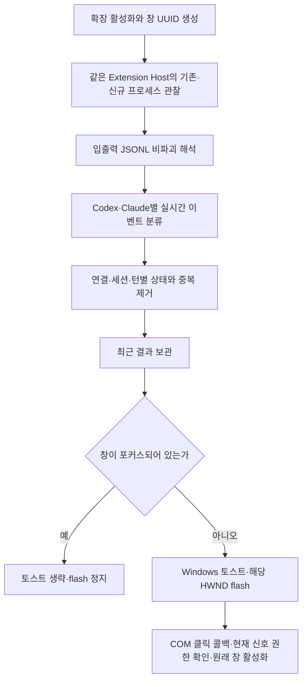

# Job-Finish 기능과 구현 알고리즘

갱신일: 2026-11-03 (Asia/Seoul)

## 지원 기능

Windows x64의 로컬 VS Code 창에서 기존 Codex·Claude Code 확장의 작업 완료·오류·취소·입력 요청을 자동 감지한다. 창을 보고 있지 않으면 Windows 토스트와 작업 표시줄 깜박임으로 알리고, 토스트 클릭으로 원래 창에 돌아간다. 최근 응답과 진단을 조회할 수 있다.

질문 답변·승인·취소와 대화 관리는 원래 Codex·Claude UI가 담당한다. Job-Finish는 에이전트를 직접 실행하거나 별도 App Server·SDK를 연결하지 않는다. 훅·대화 로그 감시·추가 모델 호출·주기적 상태 조회는 사용하지 않는다.

## 처리 구조

- `extension.ts`는 지원 환경과 수명만 관리한다. `vscode/application.ts`가 설정·상태 표시줄·4개 명령·창 서비스를 구성한다.
- `runtime/observe.ts`는 설치된 확장 경로와 프로세스 실행 인수를 함께 확인한다. Node 내부 spawn·활성 핸들 API를 사용하므로 제공자나 VS Code 변경에 영향을 받을 수 있다.
- `ObservedConnection`은 원래 stdin write의 receiver·인자·반환값을 유지하고 stdout을 소비·수정하지 않는다. 프로세스 exit 뒤 남은 stdout도 end/close까지 해석한다.
- `AgentEventRouter`는 관찰 연결과 세션을 소유한다. 지원 제공자는 Codex·Claude 두 개이며 직접 실행·확장 등록·사용자 입력 중계 계약은 없다.
- `core/Session`은 연결 안의 턴·요청 ID와 제목·최종 본문을 메모리에서 추적한다. 체크포인트·파일 소유권 잠금·재개·복구 이력은 저장하지 않는다.
- `core/Notifications`는 신호 권한·활성화 설정·포커스에 따라 결과와 토스트·flash를 처리한다.
- Windows 코드와 C# helper는 HWND 검증·등록·전송·클릭 승인을 담당한다. helper 전송 프로세스와 클릭 채널은 서로 다른 수명을 갖는다.

## 이벤트 판정

Codex는 `turn/completed`의 completed·failed·interrupted로 완료·오류·취소를 확정한다. 최종 agentMessage는 본문만 갱신한다. 임시·하위 스레드를 제외하고 저장 이력은 제목만 제공한다. 동기 승인·질문 요청은 입력 대기로 알리며 실제 해소를 관찰한다. 비동기 질문은 `item/started`와 `item/completed`의 질문을 동일한 턴·항목 키로 한 번만 알리고, 실행 상태와 최종 응답을 바꾸지 않는다.

Claude는 기존 확장의 user·system init·result·control 요청/응답을 관찰한다. 결과 UUID·요청 UUID·본문 형식을 검증한 후 세션에 반영한다. 늦게 부여된 사용자 UUID는 임시 턴에서 이전한다. 성공한 interrupt 응답으로 취소를 확정하며 프로세스 종료나 assistant 본문만으로 완료를 추정하지 않는다.

Codex의 이름·이름 변경·미리보기·첫 요청, Claude의 첫 요청을 세션 제목으로 사용한다. 제어 문자와 공백을 정리하고 최대 100자로 제한한다.

## 알림과 상태 상한

- 관찰 연결 16개, 연결별 세션 32개. 세션 상한에 도달하면 실행·입력 대기가 없는 세션만 제거한다.
- 세션별 활성 턴 32개, 입력 요청 128개, 완료·질문·요청 중복 기록 512개. 입력 요청은 해소를 추적할 턴 ID만 보관하며 식별자는 1024자로 제한한다. Codex 턴·항목 식별자는 256자로 제한한다.
- JSONL 프레임은 1 MiB. 잘못된 프레임은 해당 관찰만 해제하며 원래 에이전트를 중단하지 않는다.
- 최근 결과 20개, 응답 본문 16 KiB, 토스트 본문 180자, 진단 100개. UTF-8 문자를 중간에서 자르지 않는다.
- 비동기 질문을 알린 뒤 같은 턴이 5초 이내 정상 완료되면 결과는 보관하고 추가 토스트·flash를 합친다. 질문 전송 실패·정책 취소는 완료로 대체하며 오류·취소·다른 턴은 별도로 알린다.
- 알림 클릭 승인은 원래 확장과 채널이 유지되는 최대 5분 동안 유효하다. 설정 해제·알림 교체·확장 종료는 해당 권한을 취소한다.

창 UUID와 관찰 연결로 원래 VS Code 창을 구분한다. 같은 프로젝트·같은 제목·같은 세션 ID만으로 다른 창의 결과를 합치지 않는다. 실제 포커스로 관측한 HWND의 PID·실행 파일·수명을 확인하며, 최소화된 창만 복원하고 최대화 상태를 유지한다. 창을 확인하지 못하면 토스트만 표시한다.

## 공개 설정과 명령

설정은 General의 `enabled`와 Notifications의 `toast`, `toastIcon`, `toastIconPath`, `flash`, `flashMode`, `flashTimeoutSeconds`다. 자동 감지는 기본으로 켜지고 설정 변경은 즉시 적용된다.

명령은 **Show Results**, **Bind This Windows Window**, **Stop Flash**, **Show Diagnostics** 네 개다. 상태 표시줄은 결과 목록을 연다. 질문 답변이나 실행 제어 명령은 제공하지 않는다.

## 지원 범위와 검증

같은 로컬 Extension Host 안의 기존·신규 프로세스를 지원한다. 별도 Extension Host·WSL·원격 에이전트·외부 터미널·웹 호스트는 자동 감지 범위에 포함되지 않는다. 알림에는 추가 로그인이나 별도 Claude SDK 런타임이 필요 없으며 기존 확장의 인증을 사용한다.

`npm run check`는 제품·테스트 타입 검사, 회귀 테스트, 확장·C# 빌드를 수행한다. 실제 Extension Host의 단일·이중 창, 합성 10만 턴, C# 등록·COM 승인 계약과 격리 VSIX 설치를 별도로 검사한다. 실제 모델의 새 응답과 Windows 배너 시각·마우스 클릭은 계약 검사와 구분한다. 확인한 결과는 [검증 보고서](verification.md), 설계 근거와 과거 결정은 [일지](일지.md)를 따른다.
